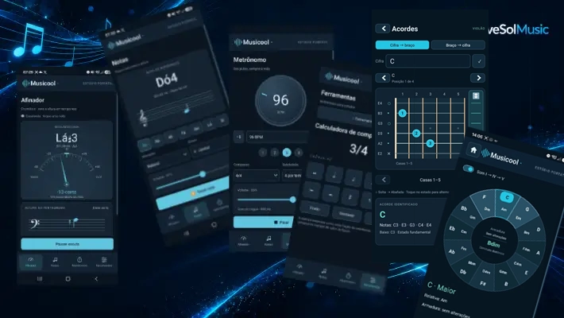

Title: Musicool
Description: Do afinador ao metrônomo - Musicool.
Category: links
Image: Musicoolarticle.webp

## Sobre o aplicativo

De fato, uma caixa de ferramentas.

### Afinador

O Musicool está completamente renovado! 

Em sua primeira tela, temos a apresentação do aplicativo, que conta com o **Afinador**, **Metrônomo** e **Gerador de Frequências** das notas, para conferência da afinação. 

Logo na segunda linha de cards encontra-se **Ferramentas** (da qual descrevo mais abaixo), **Tour** e **Compartilhar**, para compartilhar o link do ***Musicool*** com outros músicos.

E na terceira linha de cards, tem a opção de "Vale R$ 1,00", para quem quiser colaborar com o desenvolvimento desse e de outros aplicativos gratuitos, através de PIX.

### Notas

Na aba **Notas**, há um belíssimo gerador de frequência, que também exibe a nota na altura, permitindo acidentes e ajuste de volume. 

### Metrônomo

Na aba Metrônomo você encontrará o melhor metrônomo que há, permitindo diferentes compassos, subdivisão, ajuste de frequência para o som do click, ajuste de BPM e volume. Além do dial de ajuste do BPM, ainda há o ajuste fino nas laterais, através dos botões "+" e "-", fazendo incremento ou decremento unitário.

### Ferramentas

O menu **Ferramentas** conta agora com uma **Calculadora de Compasso**, um **Gerador de Acordes** que permite digitar o acorde ou montar o acorde no braço do violão - e também permite tocá-lo! Além disso, foi adicionada a **Roda das Quintas**, que é um mapeamento harmônico para fazermos progressão harmônica e identifcar os acordes que correspondem a uma sequência. Ao tocar na tonalidade ou em sua relativa menor, uma progressão harmônica de exemplo (IV-I-V) é tocada. São mostrados os graus e a armadura de clave da tonalidade, entre outros recursos.
 Há também o ajuste da frequência de Lá, que em algumas orquestras é 442Hz, mas já existiu o Lá 338Hz, muito comum nos (nada saudosos) telefones públicos, cuja frequência gerada ao tom de linha era justamente a frequência que alguns violonistas usavam como referência para afinação.

### Grátis e sem propaganda

O [Musicool](https://play.google.com/store/search?q=musicool&c=apps&hl=pt_BR) é sem dúvidas o melhor aplicativo disponível na [Play Store](https://play.google.com/store/games?hl=pt_BR). Não contém anúncios, nem vendas no aplicativo, nem conexão externa. É um aplicativo totalmente offline e já tem mais de 1 ano de existência. Foi desenvolvido essencialmente para uso dos músicos da orquestra da Congregação Cristã no Brasil, a maior orquestra do mundo, com mais de 250.000 músicos. Produzi o aplicativo gratuito justamente por esse propósito.

## Acessar o aplicativo Musicool

Você pode fazer o download para Android diretamente na Play Store, digitando "Musicool" ou então Diretamente na Play Store, clicando nesse [link do Musicool](https://play.google.com/store/games?hl=pt_BR).

E a [página do Musicool](https://musicool.clavesol.com.br), para saber mais a respeito.
